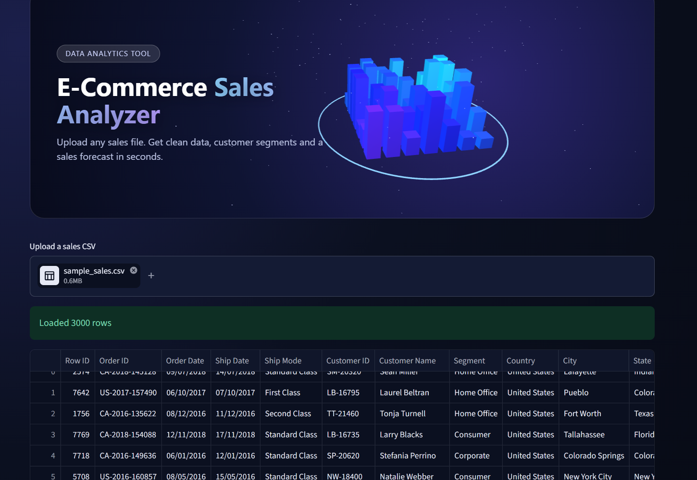
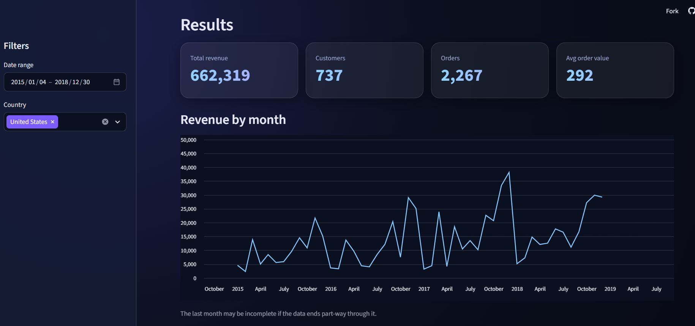
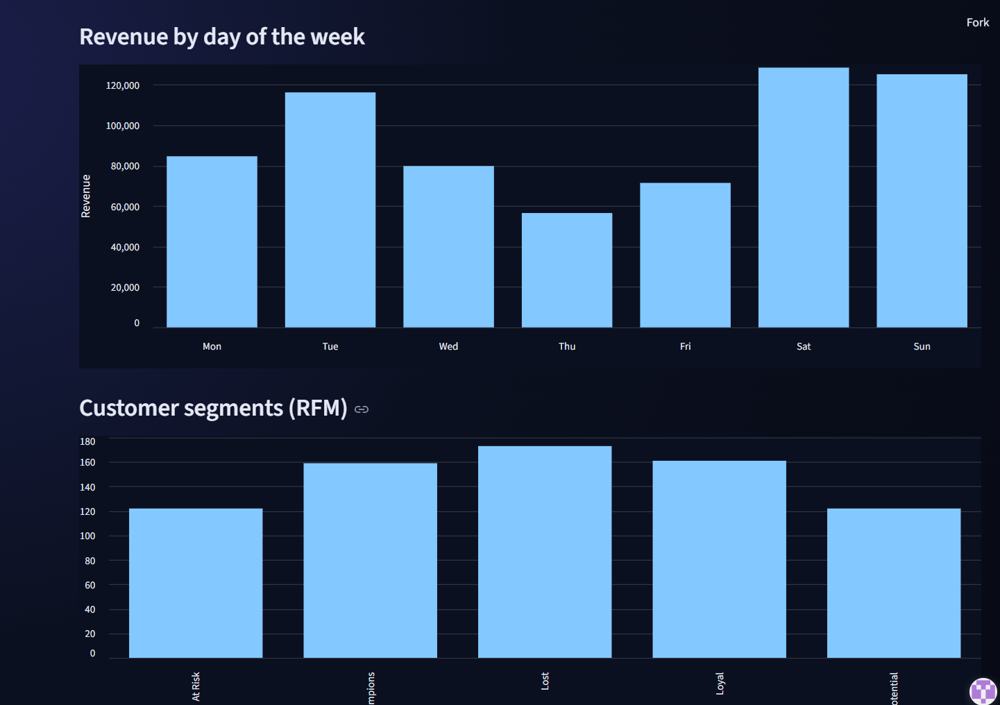

# E-Commerce Sales Analyzer

Upload a sales CSV, tell the app which column is which, and get clean data, business insights, customer segments and a sales forecast.

**Live app:** https://ecommerce-sales-analyzer.streamlit.app/



## What it does

- **Works on different sales files.** You map your own columns (date, sales amount or quantity and price, order ID, customer, country, product). Anything your file doesn't have can be set to "(none)", and the related charts are skipped.
- **Inspects and cleans the data.** Removes duplicates, missing customers, cancelled orders, invalid values and extreme outliers, and shows a clear message if a required column is missing.
- **Shows the business picture.** KPI cards, monthly revenue, top products, top countries and revenue by weekday, with date and country filters.
- **Segments customers with RFM analysis** (Recency, Frequency, Monetary): Champions, Loyal, At Risk, Lost and Potential.
- **Forecasts daily revenue** with Linear Regression and Random Forest, compared against a simple baseline.




## Results on the two datasets I tested

**1. Online retail data (UK, 541,909 rows)**

| Finding | Result |
|---|---|
| Rows after cleaning | 392652 |
| Best month | November 2011 (holiday season) |
| UK share of revenue | about 82% |
| Top product by revenue | REGENCY CAKESTAND 3 TIER |
| Outlier removed | one cancelled order of 80,995 units that inflated revenue by about 168K |

Forecast on the test period (last 20% of days):

| | Baseline (copy yesterday) | Linear Regression | Random Forest |
|---|---|---|---|
| MAE | 19,459 | 12,441 | 12,009 |
| RMSE | 24,512 | 15,834 | 16,127 |
| R2 | -0.54 | 0.36 | 0.33 |

Both models cut the average daily error by about 36 to 38% compared with the baseline.

**2. Superstore data (9,800 rows, one sales amount per row, day/month/year dates)**

The file has no quantity or price columns, and its order IDs start with "CA-" (California). The cleaning rules had to be changed to handle both. After cleaning, 9,799 rows remained.

## Honest limitations

- It works on **transaction-level sales data**: one row per sale or order line, with a date and an amount. It is not built for other kinds of data.
- Forecast quality depends on the data. R2 is about 0.35 on the retail data and close to zero on the superstore data, where daily sales are very noisy. The models learn weekly and monthly patterns, not large one-off orders.
- Dates like `03/04/2020` can be day-first or month-first. The app picks the first matching format.
- The uploader accepts CSV only, and very large files may fail on the free hosting tier.
- Cancellation and outlier rules are based on the two files tested, so check the cleaned row count on a new file.

## How it works

```
upload CSV -> map columns -> check required columns -> remove duplicates
-> drop missing customers -> remove cancelled orders -> remove invalid rows
-> remove outliers -> convert dates -> add revenue
-> KPIs, charts, RFM segments, forecast
```

Key ideas:

- **Column mapping:** the user's columns are renamed to standard names, so the same code runs on different files.
- **Adaptive outlier rule:** values above the 99.99th percentile are removed, instead of a fixed number.
- **Time-ordered train/test split:** the model trains on the first 80% of days and is tested on the last 20%, so it never sees the future.
- **Baseline comparison:** a model is only useful if it beats "tomorrow equals yesterday".

## Project structure

```
app.py            Streamlit interface
analyzer.py       cleaning, RFM and forecasting functions
hero.py           3D header banner (Three.js)
styles.css        custom styling
requirements.txt  libraries to install
sample_data/      a small sample file to try the app
notebooks         exploration and learning notebooks
```

## Run it locally

```
git clone https://github.com/HiralRathod04/sales-analyzer.git
cd sales-analyzer
pip install -r requirements.txt
streamlit run app.py
```

Then upload `sample_data/sample_sales.csv`.

## Built with

Python, Pandas, scikit-learn, Streamlit, Three.js

## What I would improve next

- Accept Excel files and more date styles
- Let the user choose day-first or month-first dates
- Add features that explain large spikes, such as days until Christmas
- Download buttons for the cleaned data and the segment table
- A custom front end (React) using the same analysis code as a backend
